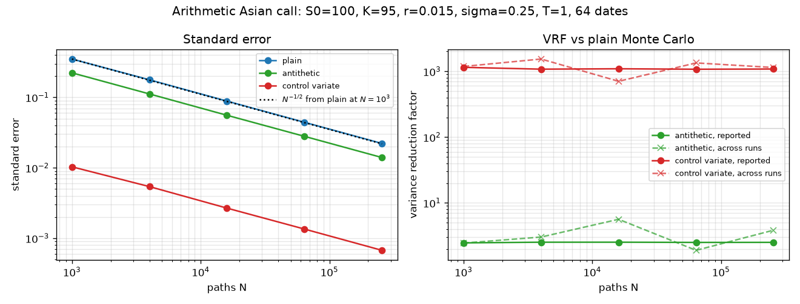
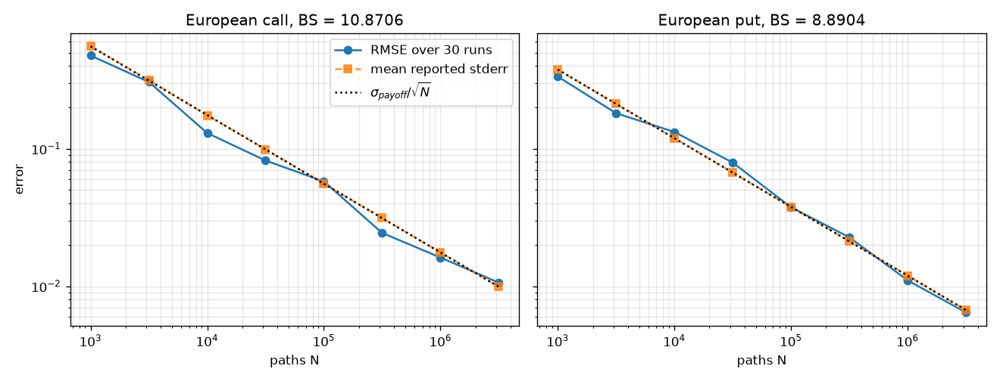

# Monte Carlo option pricer

[](https://github.com/joshcc27/monte-carlo-option-pricing/actions/workflows/tests.yml)

I wrote this library and Streamlit app to price European, arithmetic Asian, and barrier options by Monte Carlo under Black-Scholes assumptions. Each estimator is tested against a closed-form price where one exists, and against an independent estimator where it doesn't. For an arithmetic Asian call, the control variate cuts the paths needed for a one-cent 95% half-width from 4.8 million to about 4,000.

**The app:** [open it on Streamlit Community Cloud](https://joshcc27-monte-carlo-option-pricing-app-ozs8p4.streamlit.app/)

The parts that took the most care:

- Greeks by pathwise derivatives and by finite differences with common random numbers, both compared with Black-Scholes.
- Antithetic sampling, with the standard error taken over pair means because the two paths in a pair aren't independent.
- A control variate for the arithmetic Asian option. The geometric Asian has an exact price and moves almost in step with the arithmetic one, so it makes a strong control.
- Sobol sampling, with an optional Brownian-bridge construction and the error measured across independent scrambles.
- Barrier options monitored at discrete dates, with an optional Broadie-Glasserman-Kou correction to approximate continuous monitoring.



## Results

All numbers come from the committed notebooks and script and are reproducible with the seeds they set.

| Experiment | Result |
| --- | --- |
| Arithmetic Asian call, 64 dates, $S_0=100$, $K=95$, $r=1.5\%$, $\sigma=25\%$, $T=1$ | Control variate cuts variance by a factor of about 1,080 (standard error 33 times smaller); antithetic by 2.5 |
| Same contract, paths for a 95% half-width of one cent | Plain 4.8 million, antithetic 1.9 million, control variate 4,000 |
| European call and put, $N$ from $10^3$ to $3\times10^6$ | RMSE slope $-0.48$ and $-0.49$ against $\log N$, on the $\sigma/\sqrt{N}$ line; no detectable bias |
| 95% CI coverage over 2,000 runs, at-the-money call | 94.6% to 95.4% at $N = 100$, $1{,}000$ and $10{,}000$ |
| 95% CI coverage, $K=160$ call (price 0.44) | 75.7% at $N = 100$, 92.6% at $N = 1{,}000$, 94.7% at $N = 10{,}000$ |
| Down-and-out call, $K=100$, $H=90$, 52 monitoring dates | Discrete price 0.52 above the continuous closed form (8.6655); 0.02 above with the BGK correction (stderr 0.023) |

Sources: [notebooks/02](notebooks/02_asian_variance_reduction_benchmark.ipynb) for the Asian rows, [notebooks/01](notebooks/01_european_monte_carlo_convergence.ipynb) for the European rows, and [scripts/barrier_continuity_correction.py](scripts/barrier_continuity_correction.py) for the barrier row.



## Quick start

Requires Python 3.11 or later and [uv](https://docs.astral.sh/uv/).

```bash
uv sync --extra dev                   # create .venv with the package and dev tools
uv run pytest                         # 115 tests, about 30 seconds
uv run streamlit run app.py           # web app at http://localhost:8501
uv run python scripts/barrier_continuity_correction.py
```

To re-run a notebook top to bottom:

```bash
uv run jupyter nbconvert --to notebook --execute --inplace notebooks/02_asian_variance_reduction_benchmark.ipynb
```

## Streamlit app

| Page | What it does |
| --- | --- |
| Pricer | Prices a European, arithmetic Asian or barrier option with plain, antithetic or (Asian only) control-variate sampling. Shows the payoff histogram, the Black-Scholes price for Europeans and the continuous closed form for down-and-out and down-and-in calls, with each error in standard errors. |
| Greeks | Delta, vega, gamma, theta and rho of a European option by Monte Carlo, each compared with Black-Scholes in standard errors. |
| Convergence | RMSE against path count (powers of two) for pseudo-random, Sobol and Sobol with Brownian bridge, over several seeds or scrambles. |
| Variance Reduction | Standard error, variance reduction factor, run time and efficiency gain of plain, antithetic and control-variate estimators for an arithmetic Asian call. |
| Binomial | CRR tree prices of a European and an American option, the early-exercise premium, and convergence as the steps increase. |

Every page shows a result for its default inputs as soon as it opens, and the market inputs carry over between pages. The charts are drawn with Altair, so they stay legible on a phone. Each simulation is capped at about 650 MB, so a request such as 500,000 paths × 252 steps is refused rather than crashing a free Community Cloud app.

The app can be deployed from Streamlit Community Cloud with `app.py` as the entry point. Streamlit and pandas are regular dependencies of the package, and Altair comes with Streamlit, so a plain install is enough to run it.

## Library usage

```python
from mc_pricer import (
    RNG,
    bs_price,
    mc_price_asian_arithmetic_cv,
    mc_price_european,
    simulate_gbm_paths,
)

S0, K, T, r, sigma = 100.0, 105.0, 1.0, 0.02, 0.2
paths = simulate_gbm_paths(S0, T, r, sigma, steps=1, n_paths=200_000, rng=RNG(seed=42))
print(mc_price_european(paths[:, -1], K, T, r, option_type="call"))  # price, stderr, ci_low, ...
print(bs_price(S0, K, T, r, sigma, option_type="call"))

asian = mc_price_asian_arithmetic_cv(
    S0, K, T, r, sigma, steps=64, n_paths=100_000, rng=RNG(seed=1), option_type="call"
)
print(asian)
```

Every pricer returns the same dictionary: `price`, `stderr`, `ci_low`, `ci_high`, `n_paths` and `extra`. Market arguments always come first in the order `S0, K, T, r, sigma`, with the barrier level after `K` for barrier options. Functions that work on simulated paths take the paths in place of `S0`. Everything else (`steps`, `n_paths`, `rng`, `option_type` and so on) is keyword-only.

## Methods

GBM is simulated in log space, so values on the time grid are exact for any step size. European payoffs therefore need only one step.

The pathwise Greeks differentiate the payoff along each path, using $\partial S_T/\partial S_0 = S_T/S_0$ for delta and $\partial S_T/\partial \sigma$ for vega. The finite-difference Greeks reuse the same shocks for the bumped runs (common random numbers). Gamma, theta and rho are finite differences only. The gamma standard error grows like $h^{-1/2}$ as the bump $h$ shrinks, and a test checks this.

Antithetic shocks are drawn as pairs $(Z, -Z)$, and the standard error is computed over the $N/2$ pair means.

For prices observed at $t_1, \dots, t_n$, the log of the geometric average $G$ is normal with

$$
\mathbb{E}[\log G] = \log S_0 + \left(r - \frac{\sigma^2}{2}\right)\bar{t},
\qquad
\operatorname{Var}[\log G] = \frac{\sigma^2}{n^2} \sum_{i=1}^{n} \sum_{j=1}^{n} \min(t_i, t_j),
$$

where $\bar{t}$ is the mean monitoring time. With one date this reduces to Black-Scholes, which a test checks. The control-variate coefficient $b = \operatorname{Cov}(X, Y)/\operatorname{Var}(Y)$ is fitted on the same paths.

Sobol points are scrambled and mapped to normals by the inverse CDF. With the Brownian bridge, the first coordinate sets $W(T)$, the second $W(T/2)$, and so on, so the best-distributed coordinates carry most of the path variance.

Barriers are checked on the simulated dates only. The BGK correction moves the barrier towards spot by a factor $e^{0.5826\,\sigma\sqrt{\Delta t}}$. Barriers on the wrong side of spot are rejected.

The Cox-Ross-Rubinstein tree uses $u = e^{\sigma\sqrt{\Delta t}}$ and raises an error when $e^{r\Delta t}$ falls outside $(d, u)$, where the risk-neutral probability would leave $[0, 1]$. For American exercise, each node takes the larger of the continuation value and immediate exercise. Without dividends this never changes a call, which a test checks.

## Limitations

- Barrier monitoring is discrete. Without the correction you get the price of a contract checked only on the simulated dates. The BGK correction reduces the error to a smaller order than $\sqrt{\Delta t}$, but it assumes equally spaced dates.
- Greeks are for European options only. There are no Greeks for Asian or barrier options, where pathwise derivatives of the barrier indicator would need likelihood-ratio or smoothing methods.
- Only the binomial tree handles American exercise. The Monte Carlo pricers are European-style, and nothing in the project handles Bermudan exercise.
- The standard error the pricers print assumes independent samples, so it means nothing for Sobol paths. Use the spread over several scrambles instead, as the Convergence page does. Sobol also needs path counts that are powers of two. Without the Brownian bridge, its advantage fades as the number of time steps grows.
- The model is Black-Scholes with constant rate and volatility and no dividends.

## Repository layout

```text
app.py                         Streamlit entry point: the page list and navigation
app_common.py                  Page list, shared market inputs, memory check and chart display
pages/                         Overview, Pricer, Greeks, Convergence, Variance Reduction, Binomial
.streamlit/config.toml         Light theme, to match the overview's PNG figure
src/mc_pricer/
    asian_geometric.py         Closed-form geometric Asian price (control variate mean)
    binomial.py                CRR binomial tree, European and American exercise
    bs_analytics.py            Black-Scholes price and Greeks; continuous down-and-out call
    gbm.py                     GBM path simulation
    greeks.py                  Monte Carlo European Greeks, pathwise and finite difference
    mc.py                      Plain Monte Carlo pricers (European, Asian, barrier)
    mc_results.py              Result dictionary, discounting, i.i.d. and pair-mean stderr
    payoffs.py                 Payoffs, barrier validation, BGK barrier shift
    rng.py                     Pseudo-random and Sobol generators, Brownian bridge
    validation.py              Input checks
    variance_reduction.py      Antithetic and control-variate pricers
notebooks/
    01_european_monte_carlo_convergence.ipynb    Convergence rate, bias check, CI coverage
    02_asian_variance_reduction_benchmark.ipynb  Plain vs antithetic vs control variate
scripts/barrier_continuity_correction.py         Discrete vs continuous barrier table
docs/                          Figures produced by the notebooks
tests/                         pytest suite
```

## License

MIT. See [LICENSE](LICENSE).
